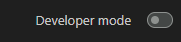
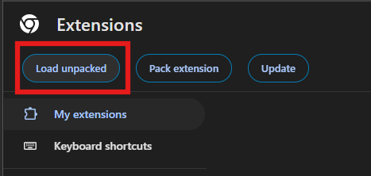
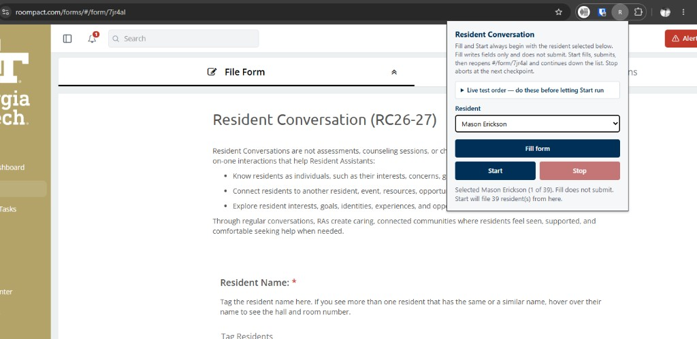
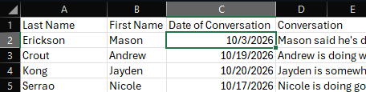
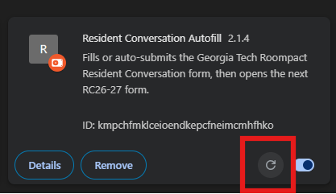

# Resident Conversation Autofill

Chrome extension that fills the Georgia Tech Roompact Resident Conversation form from `extension/resident-list.csv`. **Fill form** writes the selected resident and does not submit. **Start** fills, submits, reopens the form, and continues down the list from the person you selected.

## Install in Google Chrome

1. Open Chrome and go to `chrome://extensions`.
2. Turn on **Developer mode**. The checkbox is in the top-right corner of the extensions page.

   

3. Click **Load unpacked**.

   

4. In the folder picker, select the folder named `extension` (the one inside this project that contains `manifest.json` and `resident-list.csv`), then confirm.

Chrome adds **Resident Conversation Autofill** to the toolbar. Open a Roompact Resident Conversation form, then open the extension popup and pick a resident.

After you change `resident-list.csv`, go back to `chrome://extensions` and click the reload icon on this extension so Chrome reads the updated file.

## Fill form and Start

Pick a resident in the popup. **Fill form** fills that one resident and does not submit. **Start** fills multiple residents: it begins with the person you selected, submits each form, reopens it, and continues down the list.

## The resident list CSV

The extension reads one file: `extension/resident-list.csv`. The popup loads that file when it opens and builds the resident dropdown from it, in file order. **Start** files from the selected row through the last row.

The first row is the header and is skipped. Every row after that is one resident. A row with a blank first or last name is skipped.

| Column | Header | What it does |
| --- | --- | --- |
| 1 | Last Name | Used with the first name to find the resident on the form. The extension searches Roompact by last name, then selects the suggestion that contains both names. |
| 2 | First Name | Same as above. The dropdown label is `First Last`. |
| 3 | Date of Conversation | Written into the conversation date field. Required. Must be a real date in `mm/dd/yyyy` (month and day can be one or two digits, such as `10/3/2026`). |
| 4 | Conversation | Written into the summary notes field. Required. This is the note for that conversation. |
| 5 | Building | Written into Tag the Building. Required. The extension searches Roompact for this text and selects the matching building tag. |
| 6 | Student Population | Written into Student Population. Required. Same search-and-select behavior as Building. |
| 7 | Theme | Written into What theme(s) arose in your conversation. Required. Same search-and-select behavior as Building. |

Names, building, student population, and theme have to match the text Roompact shows for that tag. A shorter phrase still works when it appears in exactly one suggestion, such as `North Avenue North` for `North Avenue North (NAN)`. A StarRez export sometimes uses a different first name than Roompact (often a preferred name). If the names do not match, the resident tag will not be selected.

Referrals, follow-up, and supervisor are left blank.

## Editing the CSV in Excel

Open `extension/resident-list.csv` in Excel. Each resident is one row under the header, in the order they are filed. The columns are **Last Name**, **First Name**, **Date of Conversation**, **Conversation**, **Building**, **Student Population**, and **Theme**.

That picture was taken before **Building**, **Student Population**, and **Theme** were added. Those columns are to the right of **Conversation**.

Edit the cells the same way you edit any spreadsheet. Type the conversation as normal text, including commas. Excel writes the file formatting when you save. Enter the date as month/day/year, the same way the Date of Conversation column already shows it (`10/3/2026`).

Keep the header row. Every resident needs a last name, first name, date, conversation, building, student population, and theme. The current sheet uses `North Avenue North`, `Upperclass (2/3/4/5th)`, and `Not Applicable` in those last three columns. Change a cell when that resident should get a different tag. Save the file back to `extension/resident-list.csv`.

Every time you update the CSV, reload the extension by pressing the reload button on its card at `chrome://extensions` (the circular arrow). The popup only sees the copy Chrome loaded with the extension.

   
